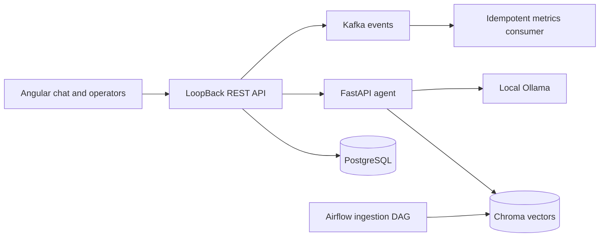

# Architecture

The implementation follows the [milestone checklist](roadmap.md). Initial
discovery found only a local implementation plan, with no source, tests, dependency
manifests, commits, or reusable Agentic RAG MCP modules. All product data is synthetic.

## Boundaries



M1 builds only the agent boundary, ingestion, and synthetic ticket fixture. Conversation persistence belongs to M2. The agent is stateless. The API
owns conversation authorization, message ordering, durable escalation queue,
and ticket ownership. M1 binds to loopback and uses a configured service token;
M2 passes a PostgreSQL ticket snapshot filtered by authenticated owner in each
internal request; Python replaces its fixture with this request-scoped context.
M1's escalation response is a decision for the caller. M2 commits it to a
durable PostgreSQL queue alongside both messages and an idempotent turn record.

## Agent interfaces

`POST /agent/respond`, `Authorization: Bearer <AGENT_SERVICE_TOKEN>`:

```json
{"message":"How long are backups retained?"}
```

Response (200, including safe dependency failure decisions):

```json
{
  "answer":"OrbitDesk retains daily backups for 30 days.",
  "route":"rag",
  "citations":[{"document_id":"backups.md","version":"sha256 digest","chunk_id":"stable digest","title":"Backups","source":"kb://backups.md","quote":"OrbitDesk retains daily backups for 30 days."}],
  "escalated":false,
  "reason":null,
  "ticket":null
}
```

`route` is `rag`, `ticket`, or `escalation`. `reason` is null on success, otherwise
a bounded code (`no_evidence`, `dependency_unavailable`, `unsafe_request`,
`human_requested`, `ticket_not_found`, `invalid_ticket`, `unsupported_generation`).
Ticket responses contain `ticket: {id,status,summary}` and no RAG citations.
Escalations contain explicit uncertainty and no citations. Unknown tickets never
fall through to a fabricated FAQ answer. Empty/oversized requests return 422,
missing/incorrect authentication returns 401. Response payloads never expose
exception text. `X-Request-ID` is validated as a UUID or replaced with a new UUID.
`GET /health/live` is process health; `GET /health/ready` checks index and Ollama,
returning 503 when unready. FastAPI generates the implemented agent OpenAPI at
`/openapi.json`; the public M2 contract is implemented and exported in
[apps/api/openapi.json](../apps/api/openapi.json). See [M2 details](m2.md).

## Public API contract for M2

All conversation routes require a customer identity; authenticated ownership is
checked before reading history, calling the ticket tool, or sending a message.
Operator routes require a separate operator credential. Do not expose a shared
service token to the browser. Demo auth must be documented as non-production.

| Method and route | Request | Success | Failures |
| --- | --- | --- | --- |
| POST `/api/conversations` | `{}` | 201 `{id,createdAt,messages:[]}` | 401,403,422 |
| POST `/api/conversations/{id}/messages` | `{content:string}` (1–4000 chars), `Idempotency-Key` UUID | 201 `{id,role:"assistant",content,citations,escalated,createdAt}` | 401,404,409,422,503 |
| GET `/api/conversations/{id}` | none | 200 `{id,createdAt,messages:[{id,role,content,citations,escalated,createdAt}]}` | 401,404 |
| GET `/api/operator/analytics` | none | 200 `{conversations,messages,escalations,escalationRate}` | 401,403 |

## Data model

PostgreSQL migrations in M2 create `conversations(id UUID PK, owner_id, created_at)`,
`turns(id UUID PK, conversation_id FK, idempotency_key UUID, content, created_at)`
(unique key per conversation), `messages(id UUID PK, conversation_id FK, turn_id FK,
role, content, citations JSONB, escalated BOOL, reason, route, ticket JSONB, created_at)`, `tickets(id PK, owner_id,
status, summary)`, and `escalations(id UUID PK, conversation_id FK, message_id FK,
reason, status, created_at)`. A later transactional outbox stores event UUID,
type, schema version, correlation UUID, timestamp, and payload. Consumers enforce
a unique event ID. Chroma holds chunks and metadata, never conversations/tickets.

## Retrieval and grounding

Markdown/PDF ingest produces relative-path document IDs, SHA-256 content versions,
bounded chunks, and deterministic chunk IDs. The index uses Ollama embeddings
and a cosine Chroma collection. Incremental sync embeds changed documents only,
upserts before removing obsolete chunks, and removes deleted sources after a
successful scan. Changing the embedding model requires a separate index directory.
PDF extraction uses pypdf. Ingestion is explicit, not a server-startup side effect.

Nearest-neighbor results must pass a distance threshold and lexical relevance
gate. Ollama selects an exact quote from the retrieved chunks; the server checks
that the selected quote occurs verbatim in a relevant chunk. It supplies all
citation metadata itself. This deliberately extractive first slice reduces
unsupported generation, at the cost of natural phrasing and recall. Neither
similarity nor quote validation is a proof that every answer is correct; evaluate
on the provided synthetic cases before expanding this design.

## Threat model

User messages and documents are untrusted. The model cannot invoke arbitrary tools,
SQL, shells, URLs, or writes. Ticket routing is deterministic with a constrained ID;
the token is required on the internal response endpoint. Obvious injection requests
are rejected, but pattern filters are defense in depth, not a complete injection
defense. Exact quote validation, fixed tool capabilities, curated ingestion, and
authorization at the public API are the primary boundaries. Do not ingest
unreviewed external material. Ticket fixtures contain no personal data.

Embedding/generation calls have request timeouts, response size limits, and at most
one retry for transient transport/5xx failures; malformed or client-error responses
fail immediately. Logs include only bounded route/reason codes, latency, and UUID
correlation IDs. No user text, prompts, tokens, ticket summaries, exception messages,
or document content go into logs or metrics. Local development is loopback-only;
production TLS, credential rotation, rate limiting and hardened tenant isolation
remain future work. M2 enforces conversation and ticket ownership. Host filesystem access is limited to the configured curated knowledge root.
